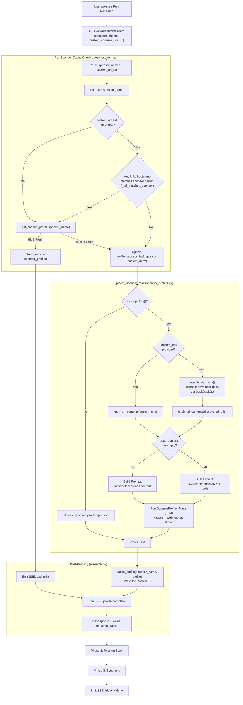
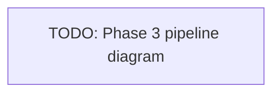

# Backend

FastAPI backend for Open Research. Exposes a single SSE endpoint that runs a three-phase agentic pipeline — sponsor profiling, prior art scan, and synthesis — streaming results to the frontend as they complete.

## Quick Start

```bash
# Recommended: handles venv, deps, and port cleanup automatically
./backend/start.sh

# Manual (run from repo root)
pip install -r backend/requirements.txt
uvicorn backend.main:app --port 8080 --reload

# Full stack with ChromaDB via Docker
docker-compose up
```

Copy `.env.example` to `.env.local` in the repo root and fill in your keys:

```
OPENAI_API_KEY=        # required for live agents; omit to run in fallback mode
FIRECRAWL_API_KEY=     # required for Firecrawl scraping; omits falls back to httpx
```

## API

### `GET /api/research/stream`

Returns an `EventSourceResponse` (SSE). All pipeline progress, results, and errors are emitted as events over this single connection.

| Param | Type | Required | Notes |
|---|---|---|---|
| `sponsors` | `str` | Yes | Comma-separated sponsor names |
| `theme` | `str` | Yes | Hackathon theme description |
| `interests` | `str` | No | Comma-separated interest tags |
| `seed` | `str` | No | Optional seed idea or constraint |
| `skills` | `str` | No | Comma-separated team skill tags |
| `time_budget` | `str` | No | `"24h"`, `"36h"`, or `"48h"` |
| `depth` | `int` | No | Research depth 0–3 (default 1) |
| `custom_sponsor_urls` | `str` | No | Comma-separated URLs to scrape for sponsor docs |

Returns HTTP 422 if `sponsors` or `theme` are missing.

### SSE Event Protocol

| Event | Payload | Notes |
|---|---|---|
| `log` | `{id, step, text, final?}` | Pipeline progress; `step` format is `"NN · LABEL"` |
| `synergy` | `{text}` | One-line sponsor synergy insight |
| `ideas` | `IdeaBrief[]` | Final ranked idea list |
| `done` | `{}` | Stream complete — close the EventSource |

## Project Structure

```
backend/
├── main.py                  # App entrypoint, loads .env, mounts router
├── routers/
│   └── research.py          # GET /api/research/stream + _generate() pipeline
├── agents/
│   ├── sponsor_profiler.py  # Phase 1: SponsorProfiler agent
│   ├── prior_art.py         # Phase 2: PriorArtResearcher agent
│   └── synthesizer.py       # Phase 3: Synthesizer agent + all Pydantic models
└── core/
    ├── cache.py             # ChromaDB sponsor profile cache
    ├── fetch_urls.py        # Firecrawl / httpx URL scraping utility
    ├── search.py            # DuckDuckGo search (tool + raw URL helper)
    ├── stream.py            # SSE serialization helper
    ├── fallback.py          # Static profiles/ideas for zero-key mode
    └── mock_search.py       # Deterministic mock prior-art data
```

## Pipeline Overview

The `_generate()` async generator in `routers/research.py` orchestrates three sequential phases. Phases 1 and 2 run per-sponsor tasks in parallel using `asyncio.create_task` + `asyncio.wait`.

### Phase 1 — Sponsor Profiling

Produces a Markdown profile for each sponsor covering their APIs, hackathon tracks, canonical use cases, and judge signals. Results are cached in ChromaDB (TTL: 7 days).



### Phase 2 — Prior Art Scan

For each sponsor, searches Devpost and X/Twitter for prior hackathon projects and community signals. Runs in parallel across sponsors using the same task-pool pattern as Phase 1.

Agent: `PriorArtResearcher` — receives sponsor name + first 800 chars of the Phase 1 profile as context. Output: Markdown summary (≤300 words) of winning problem categories, technical patterns, and judge signals.

> **Note:** Real Devpost/X scraping is not yet implemented. The `mock_search_prior_art_tool` returns deterministic mock data. Pipeline diagram TBD.


### Phase 3 — Synthesis

A single sequential call to `synthesize_task()`. The `Synthesizer` agent reasons over all sponsor profiles, prior art summaries, and user inputs (theme, interests, skills, seed, time budget) to produce ranked `IdeaBrief` objects.

No external tools — pure reasoning over provided context. On success emits a `synergy` event followed by an `ideas` event. On failure emits an error log and `done`.

> **Note:** Pipeline diagram TBD.



## Pydantic Models

All defined in `agents/synthesizer.py`. The frontend TypeScript interfaces in `frontend/src/data.ts` mirror these exactly.

```
Breakdown        sponsor: int, interest: int, novelty: int
PriorArtRef      title: str, meta: str, url: str
IdeaBrief        id, title, pitch, stack: list[str], match: int (65–95),
                 breakdown: Breakdown, difficulty: int (1–3),
                 priorArt: PriorArtRef, why: str, risks: str, demoMoment: str
SynthesisResult  synergy: str, ideas: list[IdeaBrief]
```

## Environment Variables

| Variable | Required | Default | Notes |
|---|---|---|---|
| `OPENAI_API_KEY` | No | — | Absence triggers full fallback mode |
| `FIRECRAWL_API_KEY` | No | — | Absence falls back to httpx HTML fetch |
| `OPENAI_AGENTS_DISABLE_TRACING` | No | — | Set to `"1"` in `main.py` at startup |
| `CHROMA_HOST` | No | — | If set, uses ChromaDB HTTP server |
| `CHROMA_PORT` | No | `8000` | Used with `CHROMA_HOST` |
| `CHROMA_PATH` | No | `backend/chroma_db` | Local persistent ChromaDB path |
| `SPONSOR_PROFILE_TTL_DAYS` | No | `7` | Sponsor profile cache TTL in days |

Loaded from `.env` and `.env.local` in both `backend/` and the repo root.

## Fallback Mode

When `OPENAI_API_KEY` is absent all three agents return pre-written static data from `core/fallback.py`. The full SSE stream fires normally — the frontend cannot distinguish fallback mode from live mode. Covers 8 built-in sponsors: Groq, Anthropic, Modal, Supabase, Vercel, ElevenLabs, Mistral, Pinecone.

## Error Handling

- Cache errors in Phase 1 are caught per-sponsor; the pipeline continues without cache.
- Per-sponsor task failures in Phase 1/2 emit an error log event but do not abort the run.
- If `sponsor_profiles` is empty after Phase 1, Phases 2 and 3 are skipped and `done` is emitted.
- Synthesis failure emits an error log event followed by `done`.
